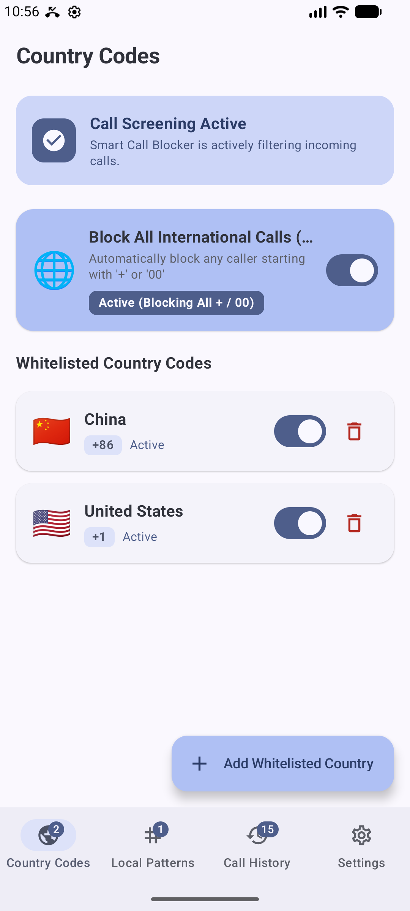
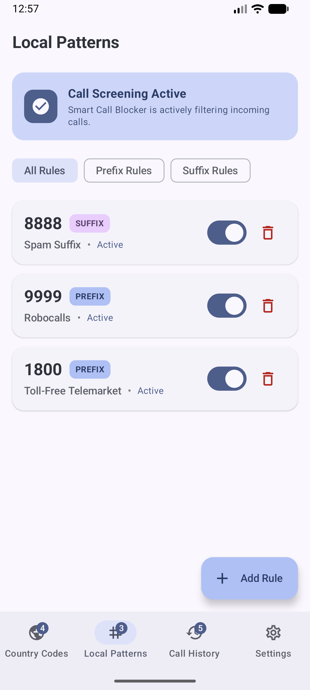
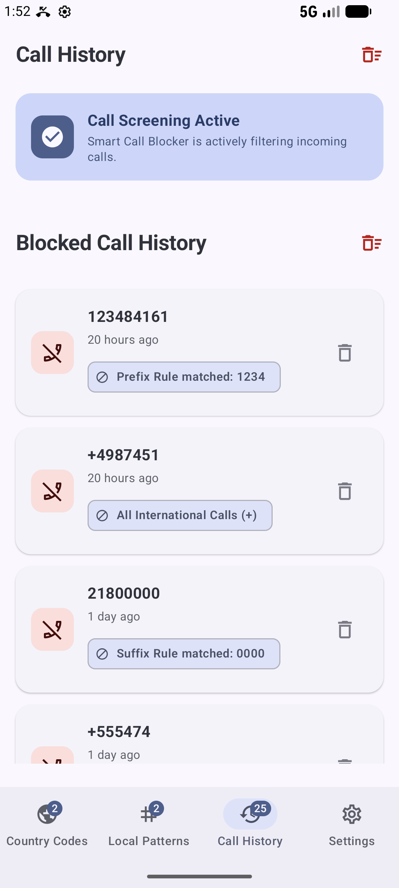
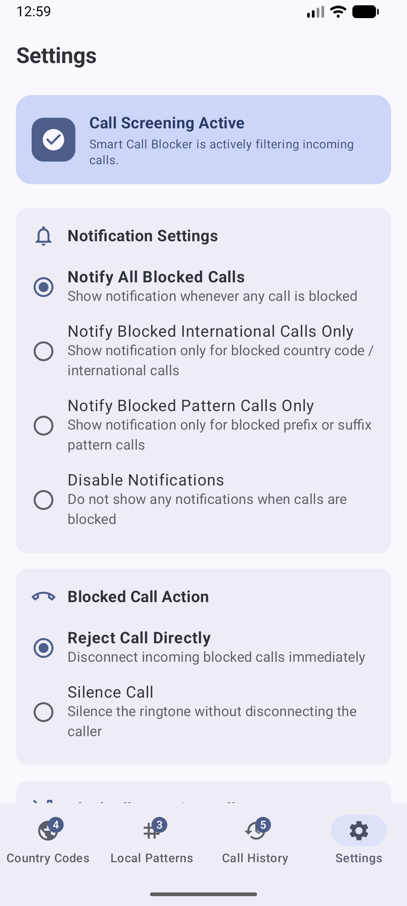

# Smart Call Blocker (v1.4.0) 🛡️📞

[](https://developer.android.com)
[](https://kotlinlang.org)
[](https://developer.android.com/jetpack/compose)
[](https://developer.android.com/reference/android/telecom/CallScreeningService)


**Smart Call Blocker** is a modern, feature-rich Android application designed to protect users from unwanted telemarketers, spam calls, robocalls, and international scams. Built with **Kotlin**, **Jetpack Compose Material 3**, and Android's native Telecom `CallScreeningService`, it provides real-time, low-latency call interception without sacrificing battery life or privacy.

---

## 📱 Screenshots Gallery

| 🌐 Country Codes | 🏷️ Local Patterns |
| :---: | :---: |
|  |  |

| 📜 Call History | ⚙️ Settings |
| :---: | :---: |
|  |  |

---

## ✨ Key Features

- 🌐 **Country Code Whitelisting**:
  - Master toggle: **"Block All International Calls (+)"** automatically blocks any incoming call starting with `+` or `00`.
  - **Whitelisted Country Codes**: Allow specific country codes (e.g. `+44`, `+1`) to pass through even when international blocking is active.
- 🏷️ **Local Prefix & Suffix Pattern Matching**: Block specific local prefix numbers (e.g. `1800` toll-free telemarketers, `9999` robocall pools) or suffix number patterns with custom descriptive labels. Filter rules instantly by *All*, *Prefix*, or *Suffix*.
- 🕵️ **Private / Hidden Caller Blocking**: Detect and block withheld, anonymous, or private callers. E.g. Hong Kong `133` withheld presentation and restricted numbers.
- 🛑 **Block All Incoming Calls**: Flexible master blocking mode supporting:
  - **Disabled**: Standard rule-based call filtering.
  - **Always**: Block all incoming phone calls immediately.
  - **Scheduled**: Block all calls during a user-defined daily time window (e.g. `22:00` to `07:00` for Do-Not-Disturb / quiet hours).
- 🔕 **Custom Block Action**:
  - **Reject Call**: Instantly disconnect blocked incoming callers.
  - **Silence Call**: Silence the ringtone while letting the call terminate naturally without immediate disconnection.
- 🔔 **Granular System Notifications**: Native Android 13+ (`POST_NOTIFICATIONS`) notification management:
  - Notify all blocked calls.
  - Notify international blocked calls only.
  - Notify pattern-matched blocked calls only.
  - Disable all block notifications.
- 📜 **Blocked Call History Activity Log**: Persistent log of all blocked calls with timestamp, caller ID, reason for block, single-item deletion, and batch clear capabilities.

---

## 🏗️ Architecture & Tech Stack

Smart Call Blocker follows modern Android development best practices with **Unidirectional Data Flow (UDF)** and clean separation of concerns.

```
                    +---------------------------------------+
                    |        Jetpack Compose UI             |
                    |  (Material 3 Adaptive & Navigation)   |
                    +-------------------+-------------------+
                                        |
                                        v
                    +-------------------+-------------------+
                    |      ViewModels & StateFlow           |
                    | (Rules, History, Settings ViewModels) |
                    +-------------------+-------------------+
                                        |
                                        v
                    +-------------------+-------------------+
                    |    CallBlockerRepositoryImpl      |
                    |   (Room DB + SharedPreferences)   |
                    +-------------------+-------------------+
                                        ^
                                        |
+------------------------------+        |
|  SmartCallScreeningService   |--------+
|  (Android Telecom Engine)    |
+------------------------------+
```

### Key Technologies
- **UI Framework**: [Jetpack Compose](https://developer.android.com/jetpack/compose) with Material Design 3 (Expressive styling, dynamic color support, adaptive navigation rails and bottom navigation).
- **Core Interception**: Android Telecom [`CallScreeningService`](https://developer.android.com/reference/android/telecom/CallScreeningService) for system-level incoming call filtering.
- **Database & Persistence**: [Room Database](https://developer.android.com/training/data-storage/room) (SQLite) with Kotlin Coroutines Flow for reactive rule and log persistence, backed by `SharedPreferences` for user app configuration.
- **Asynchronous & Reactive**: Kotlin Coroutines & `StateFlow` / `SharedFlow` with `collectAsStateWithLifecycle`.
- **Adaptive Layout**: Responsive grid layout switching automatically between `NavigationRail` (for tablets/foldables) and `NavigationBar` (for mobile phones).

---

## 🛠️ Build & Setup Guide

### Prerequisites
- **Android Studio**: Ladybug / 2024.2.1+ (or JDK 17 / Kotlin 2.0 compiler).
- **Android SDK**: `compileSdk 37`, `minSdk 29` (Android 10+).
- **Gradle**: 8.9+ with AGP 8.8+.

### 1. Clone the Repository
```bash
git clone https://github.com/flyhamburger/Smart_Call_Blocker.git
cd smart-call-blocker
```

### 2. Build Debug APK
Build the application using the Gradle wrapper:
```bash
# On Linux / macOS
./gradlew assembleDebug

# On Windows PowerShell / CMD
.\gradlew.bat assembleDebug
```

### 3. Install on Device / Emulator
```bash
# Install on connected device or emulator via Gradle
./gradlew installDebug

# Or install via ADB
adb install app/build/outputs/apk/debug/app-debug.apk
```

### 4. Enable Default Call Screening App Permission
For Smart Call Blocker to intercept incoming calls, it must be selected as the system **Default Call Screening App**:
1. Open **Smart Call Blocker** on your device.
2. If the banner indicates *Call Screening Inactive*, tap **Set as Default**.
3. Select **Smart Call Blocker** in the system default app prompt.
4. Alternatively, open **Android Settings** > **Apps** > **Default Apps** > **Caller ID & Spam App** / **Call Screening App** and choose **Smart Call Blocker**.

---

## 🧪 Unit Testing

Smart Call Blocker includes unit tests for the screening engine, repository implementations, and ViewModels:

```bash
# Run all unit tests
./gradlew testDebugUnitTest
```

---

